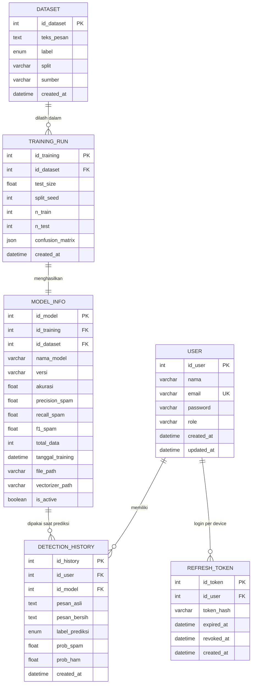

# Entity Relationship Diagram (ERD)

**Sistem Pendeteksi Pesan Penipuan Online — Metode Multinomial Naive Bayes**
Platform: Web (FastAPI + React)
Versi dokumen: 1.1

## Ringkasan Perubahan dari v1.0

| # | Masalah pada v1.0 | Perbaikan di v1.1 |
|---|---|---|
| 1 | Relasi `DATASET (1)—(1) MODEL_INFO` tidak punya foreign key di kedua tabel | Ditambahkan entitas **TRAINING_RUN** sebagai penghubung; `MODEL_INFO.id_training` (FK, unique) dan `MODEL_INFO.id_dataset` (FK) |
| 2 | `SESSION` dengan `token`/`expired_at` tidak dipakai karena autentikasi JWT stateless | Diganti **REFRESH_TOKEN** — hanya dipakai untuk refresh & logout (revocation), access token tetap stateless |
| 3 | `MODEL_INFO.is_active` BOOLEAN membolehkan banyak model aktif sekaligus | Ditambah partial unique index: tepat satu baris `is_active = TRUE` |
| 4 | Label ganda (`spam`/`ham` di DATASET, `Penipuan`/`Bukan Penipuan` di riwayat) | Kedua tabel memakai ENUM `spam`/`ham`; label Bahasa Indonesia hanya dibentuk di layer API |
| 5 | Metrik model hanya `akurasi` | Ditambah precision/recall/F1 kelas spam + confusion matrix (JSON) |
| 6 | `DATASET.is_training` per-baris menyandikan split 80/20 (tidak reproducible) | Split dipindah ke `TRAINING_RUN` (`test_size`, `split_seed`, `n_train`, `n_test`) |
| 7 | Tidak ada index untuk query riwayat & filter | Composite index `(id_user, created_at DESC)` dan `(id_user, hasil_prediksi)` |

## Diagram

## Entitas & Atribut

### 1. USER

| Field | Tipe Data | Constraint | Keterangan |
|---|---|---|---|
| id_user | INT | PK, AUTO_INCREMENT | ID unik pengguna |
| nama | VARCHAR(100) | NOT NULL | Nama lengkap |
| email | VARCHAR(254) | NOT NULL, UNIQUE, INDEX | Email login (RFC 5321 max 254) |
| password | VARCHAR(255) | NOT NULL | Hash bcrypt |
| role | ENUM('user','admin') | NOT NULL, DEFAULT 'user' | Hak akses |
| created_at | DATETIME | NOT NULL, DEFAULT CURRENT_TIMESTAMP | Waktu registrasi |
| updated_at | DATETIME | NOT NULL, DEFAULT CURRENT_TIMESTAMP ON UPDATE | Waktu update terakhir |

### 2. DETECTION_HISTORY

| Field | Tipe Data | Constraint | Keterangan |
|---|---|---|---|
| id_history | INT | PK, AUTO_INCREMENT | ID unik riwayat |
| id_user | INT | FK → USER.id_user, NOT NULL, ON DELETE CASCADE | Pemilik riwayat |
| id_model | INT | FK → MODEL_INFO.id_model, NOT NULL, ON DELETE RESTRICT | Model yang memprediksi |
| pesan_asli | TEXT | NOT NULL | Teks asli dari pengguna |
| pesan_bersih | TEXT | NOT NULL | Setelah preprocessing |
| label_prediksi | ENUM('spam','ham') | NOT NULL | Kelas hasil prediksi |
| prob_spam | FLOAT | NOT NULL, CHECK 0.0–1.0 | Probabilitas kelas spam |
| prob_ham | FLOAT | NOT NULL, CHECK 0.0–1.0 | Probabilitas kelas ham |
| created_at | DATETIME | NOT NULL, DEFAULT CURRENT_TIMESTAMP | Waktu deteksi |

**Index:** `idx_history_user_created (id_user, created_at DESC)`, `idx_history_user_label (id_user, label_prediksi)`

**Invariant:** `abs(prob_spam + prob_ham - 1.0) < 1e-6` — divalidasi di aplikasi sebelum insert.

### 3. TRAINING_RUN

Satu baris = satu kali eksekusi `train_model.py`. Inilah entitas yang membuat relasi dataset↔model dapat diaudit dan eksperimen dapat direproduksi.

| Field | Tipe Data | Constraint | Keterangan |
|---|---|---|---|
| id_training | INT | PK, AUTO_INCREMENT | ID unik run |
| id_dataset | INT | FK → DATASET.id_dataset, NOT NULL | Dataset yang dipakai |
| test_size | FLOAT | NOT NULL, DEFAULT 0.2 | Proporsi data uji |
| split_seed | INT | NOT NULL | Seed `train_test_split` (reproducibility) |
| n_train | INT | NOT NULL | Jumlah baris training |
| n_test | INT | NOT NULL | Jumlah baris testing |
| confusion_matrix | JSON | NULL | `[[TN, FP], [FN, TP]]` pada data uji |
| catatan | VARCHAR(255) | NULL | Catatan eksperimen (mis. "unigram, no stemming") |
| created_at | DATETIME | NOT NULL, DEFAULT CURRENT_TIMESTAMP | Waktu run |

### 4. MODEL_INFO

| Field | Tipe Data | Constraint | Keterangan |
|---|---|---|---|
| id_model | INT | PK, AUTO_INCREMENT | ID unik model |
| id_training | INT | FK → TRAINING_RUN.id_training, UNIQUE, NOT NULL | Run yang menghasilkan model ini |
| id_dataset | INT | FK → DATASET.id_dataset, NOT NULL | Denormalisasi untuk query cepat |
| nama_model | VARCHAR(100) | NOT NULL | "Multinomial Naive Bayes" |
| versi | VARCHAR(20) | NOT NULL, UNIQUE | Mis. "1.0.0" |
| akurasi | FLOAT | NOT NULL | Persen 0–100 |
| precision_spam | FLOAT | NOT NULL | Persen 0–100 |
| recall_spam | FLOAT | NOT NULL | Persen 0–100 |
| f1_spam | FLOAT | NOT NULL | Persen 0–100 |
| total_data | INT | NOT NULL | Jumlah baris training (**bukan** total korpus) |
| tanggal_training | DATETIME | NOT NULL | Waktu training |
| file_path | VARCHAR(255) | NOT NULL | Lokasi `naive_bayes.pkl` |
| vectorizer_path | VARCHAR(255) | NOT NULL | Lokasi `tfidf_vectorizer.pkl` |
| is_active | BOOLEAN | NOT NULL, DEFAULT FALSE | Model yang dipakai `/predict` |

**Constraint:** partial unique index `uq_model_single_active ON model_info (is_active) WHERE is_active = TRUE` — PostgreSQL. Untuk MySQL gunakan generated column + unique index, atau validasi transaksional di service layer.

### 5. DATASET

| Field | Tipe Data | Constraint | Keterangan |
|---|---|---|---|
| id_dataset | INT | PK, AUTO_INCREMENT | ID unik baris dataset |
| teks_pesan | TEXT | NOT NULL | Isi pesan |
| label | ENUM('spam','ham') | NOT NULL | Kelas ground truth |
| split | ENUM('train','test') | NULL | Diisi saat run; NULL = belum dialokasikan |
| sumber | VARCHAR(50) | NOT NULL, DEFAULT 'uci_sms_spam' | Asal data |
| created_at | DATETIME | NOT NULL, DEFAULT CURRENT_TIMESTAMP | Waktu import |

**Index:** `idx_dataset_dup (teks_pesan(191), label)` untuk deteksi duplikat saat import.

> `split` bersifat *cache* dari run terakhir. Sumber kebenaran split tetap `TRAINING_RUN` (seed + test_size).

### 6. REFRESH_TOKEN

Menggantikan `SESSION` v1.0. Access token tetap JWT stateless (60 menit); refresh token disimpan sebagai hash agar logout/revocation mungkin dilakukan.

| Field | Tipe Data | Constraint | Keterangan |
|---|---|---|---|
| id_token | INT | PK, AUTO_INCREMENT | ID unik token |
| id_user | INT | FK → USER.id_user, NOT NULL, ON DELETE CASCADE | Pemilik |
| token_hash | VARCHAR(255) | NOT NULL, UNIQUE, INDEX | SHA-256 dari refresh token (bukan plaintext) |
| expired_at | DATETIME | NOT NULL | Masa berlaku (default 7 hari) |
| revoked_at | DATETIME | NULL | Diisi saat logout / rotasi |
| created_at | DATETIME | NOT NULL, DEFAULT CURRENT_TIMESTAMP | Waktu terbit |

## Relasi Antar Entitas

1. **USER (1) ── (N) DETECTION_HISTORY** — satu user punya banyak riwayat; hapus user menghapus riwayatnya (CASCADE).
2. **MODEL_INFO (1) ── (N) DETECTION_HISTORY** — model tidak boleh dihapus selama masih dirujuk (RESTRICT), agar audit trail utuh.
3. **DATASET (1) ── (N) TRAINING_RUN** — satu dataset dapat dipakai berkali-kali (retraining, tuning hyperparameter, ablation).
4. **TRAINING_RUN (1) ── (1) MODEL_INFO** — satu run menghasilkan tepat satu model.
5. **USER (1) ── (N) REFRESH_TOKEN** — satu user dapat login dari beberapa device.

### Mengapa bukan `DATASET (1)—(1) MODEL_INFO`?

Relasi langsung memaksa dua asumsi yang salah: (a) dataset tidak bisa dipakai untuk melatih versi model berikutnya, dan (b) parameter eksperimen (split, seed, hyperparameter) tidak punya tempat penyimpanan. `TRAINING_RUN` memisahkan **input** (dataset + konfigurasi) dari **output** (model + metrik), sehingga tabel `MODEL_INFO` tetap ramping untuk dibaca saat `/model-info` dan riwayat eksperimen tetap lengkap untuk bab pengujian.

## Catatan Implementasi

- **Database:** PostgreSQL 15+ untuk production, SQLite untuk development lokal. Skema harus tetap kompatibel dengan keduanya; hindari fitur MySQL-only.
- **Migrasi:** Alembic. Tidak ada `create_all()` di production path.
- **Timestamp:** semua kolom waktu disimpan UTC (TIMESTAMPTZ di PostgreSQL), diformat ISO-8601 dengan `Z` di response API.
- **Enum label:** nilai tersimpan selalu `spam`/`ham`. Terjemahan ke `"Penipuan"`/`"Bukan Penipuan"` dilakukan di `schemas/` (Pydantic serializer), bukan di database.
- **Hapus riwayat:** `DELETE` keras pada `detection_history`; tidak ada soft delete karena tidak ada kebutuhan audit per-user pada MVP.
